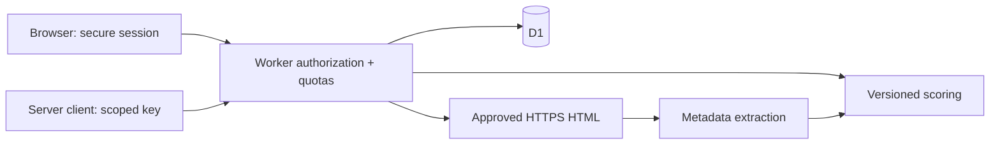

# Architecture and data model

One TypeScript Worker serves public content and the JSON API. `scripts/build-assets.mjs` embeds small public assets for atomic API or Wrangler deployment. No external fonts, frontend framework or runtime npm dependencies. Larger media should move to Static Assets/R2 in a later decision.

`scoring.mjs` is a pure versioned rules engine; `security.mjs` centralizes credential/input/origin/URL boundaries; `website.ts` parses metadata without running scripts; `worker.ts` enforces ownership; `openapi.ts` is the executable API contract.

| Table | Key / parent | Meaning |
| --- | --- | --- |
| users | id; unique normalized email | Name, scrypt verifier, recovery hash |
| sessions | token hash → user | 7-day absolute expiry |
| projects | id → user | Kind/name/input JSON/timestamps |
| analyses | id → project | Immutable result JSON, score, version |
| api_keys | id → user; unique token hash | Prefix, scope, 30-day expiry |
| rate_limits | hashed bucket | Atomic counter/expiry |
| d1_migrations | migration name | Migration ledger |

Foreign keys cascade on deletion. Prepared statements bind inputs. Project/key quotas use conditional inserts, not race-prone count-then-insert pairs. Every analysis is authorized through its project. Current model: **one owner per workspace**, not team roles.

Native scrypt uses N=16384, r=8, p=5, random salt and 32-byte output. Opaque session/API/recovery values are stored as SHA-256 hashes. Password comparison is constant time. HTTPS cookie: `__Host-elancebot; Secure; HttpOnly; SameSite=Strict; Path=/`; local HTTP uses a development cookie.

Recovery atomically consumes the code, rotates password/code and revokes all sessions/keys. Email is an unverified identifier, not proof of identity. No MFA. A stronger identity design is a production gate.

Preview and production have separate Worker names and D1 IDs; only preview is deployed. Reviews retain a scoring version. Version rules when weights change. Current small quotas bound response sizes; add pagination before increasing them. Queue expensive integrations rather than extending synchronous handlers. Metadata checks do not measure Core Web Vitals, index coverage, rankings, traffic or backlinks.
