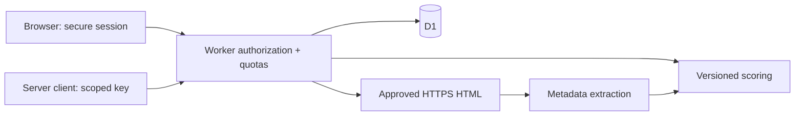

# Architecture and data model

One TypeScript Worker serves public content and the JSON API. `scripts/build-assets.mjs` embeds small public assets for atomic API or Wrangler deployment. No external fonts, frontend framework or runtime npm dependencies. Larger media should move to Static Assets/R2 in a later decision.

`scoring.mjs` is a pure versioned rules engine; `toolkit.mjs` owns the working tool catalog, input schemas and pure calculations; `security.mjs` centralizes credential/input/origin/URL boundaries; `website.ts` parses metadata without running scripts; `worker.ts` enforces ownership; `openapi.ts` serves the API contract. The UI renders calculator fields from the public catalog and never treats client validation as authorization.

| Table | Key / parent | Meaning |
| --- | --- | --- |
| users | id; unique normalized email | Name, scrypt verifier, recovery hash |
| sessions | token hash → user | 7-day absolute expiry |
| projects | id → user | Kind/name/input JSON/timestamps |
| analyses | id → project | Immutable result JSON, score, version |
| tool_state | (user, tool) → user | Private favorite and last-opened/used timestamp |
| tool_runs | id → user | Versioned normalized input/result JSON and creation time |
| api_keys | id → user; unique token hash | Prefix, scope, 30-day expiry |
| rate_limits | hashed bucket | Atomic counter/expiry |
| d1_migrations | migration name | Migration ledger |

Foreign keys cascade on deletion. Prepared statements bind inputs. Project/key/tool-result quotas use conditional inserts, not race-prone count-then-insert pairs. Every analysis is authorized through its project; every tool result and favorite is authorized directly by its owner. Current model: **one owner per workspace**, not team roles. Additive migration `0002_tool_workspace.sql` introduces the tool tables without changing existing records.

Tools run on user-supplied data without providers. Saving is optional; an unsaved run stores only the recent-tool marker, not its inputs/results. Saved results preserve their rules version and are included in account export/deletion. Limits are 60 runs/hour and 100 saved results/account. Search covers catalog text plus the current user's project and result titles, not arbitrary full content. New tool families should reuse this framework and add their own accuracy/privacy tests.

Native scrypt uses N=16384, r=8, p=5, random salt and 32-byte output. Opaque session/API/recovery values are stored as SHA-256 hashes. Password comparison is constant time. HTTPS cookie: `__Host-elancebot; Secure; HttpOnly; SameSite=Strict; Path=/`; local HTTP uses a development cookie.

## URL insights path

`POST /insights` validates authorization, source references, consent and quotas before processing. `website.ts` extracts bounded text and metadata from approved HTML, excluding scripts, navigation and explicitly hidden elements. It does not execute client-side rendering or claim to reproduce the full visible page. Marketplace URLs accept only authorized supplied snapshots. Every source preserves its URL, retrieval type, recorded time and exact analyzed text (100–8,000 characters).

`insights.mjs` provides versioned, deterministic offer/proof/process/commercial/next-step observations, exact target-phrase counts, competitor gaps and suggested actions. These signals do not establish actual quality, demand, rank or revenue. Saved source input and immutable analysis are committed in one D1 batch; quota rejection does not overwrite the prior draft. Sources are included in owner-only export and deletion. A revised snapshot is labeled as supplied, not as a live platform update.

`improvements.ts` is an optional native Workers AI adapter, disabled without an AI binding and `AI_ENABLED=true`. The operator has not enabled it. Each requested run additionally requires `aiConsent:true`; limits are 3 requests/account and 10/app per UTC day, bounded input/output and a 25-second signal. The model receives data but no execution tools. Verbatim evidence citations are validated; invalid drafts are discarded and the non-AI report remains. Citation validation cannot verify every generated claim. Live quality/adversarial evaluation and billing approval remain gates.

Recovery atomically consumes the code, rotates password/code and revokes all sessions/keys. Email is an unverified identifier, not proof of identity. No MFA. A stronger identity design is a production gate.

Preview and production have separate Worker names and D1 IDs; only preview is deployed. Reviews retain a scoring version. Version rules when weights change. Current small quotas bound response sizes; add pagination before increasing them. Queue expensive integrations rather than extending synchronous handlers. Metadata checks do not measure Core Web Vitals, index coverage, rankings, traffic or backlinks.
